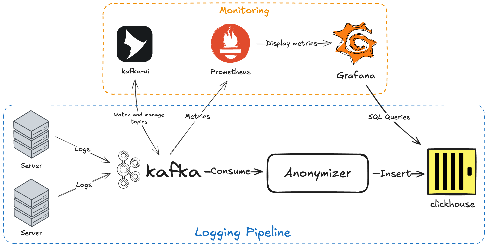

# Data Engineering Task: Anonymizer

Languages: Go, C/C++, Java, Rust.

Imagine a logging pipeline of HTTP log records: data is collected from servers and sent
to Apache Kafka. Your task is to consume those messages from Kafka, decode and transform them,
and insert them to a ClickHouse database.



## Dependencies ✅

### Required

- [Docker](https://docs.docker.com/get-started/get-docker/). The testing environment is dockerized.
- [CapNProto](https://capnproto.org/install.html). Messages you'll read are encoded in this format.

### Recommended

- [Kafka](https://kafka.apache.org/quickstart).
- [clickhouse-client](https://clickhouse.com/docs/en/getting-started/install/).

## Task description 📝

This task is a simulated example of a problem that you may encounter in a CDN. Servers
deliver content by serving HTTP requests to the users. Each request is logged. These logs
are then encoded in Cap'n Proto format and sent to Kafka. Cap'n Proto scheme is available
in [http_log.capnp](http_log.capnp). Kafka acts as a buffer between the servers and ClickHouse.
Your goal is to reliably deliver the logs from Kafka `http_log` topic to ClickHouse `http_log` table.

**Anonymization:** because of the GDPR regulations you have to anonymize the client IP. For each record change
`remoteAddr`'s last octet to `X` before sending it over to ClickHouse (e.g. 1.2.3.`4` -> 1.2.3.`X`).

### Requirements

- **Make the service reliable.** Each record must be stored to ClickHouse, even in the event of temporary network outage
  or server failure.
- **Insert in batches.** ClickHouse loves batch inserts, so you **must** batch the records. The exact batching mechanism
  is up to you.
- **Write good code.** Split the code into logical units, use meaningful variable names. We like
  self-documenting code, so please avoid comments where unnecessary.
- **Make parameters configurable.** Imagine the application will be used in production and
  make the parameters that might change—e.g. DB address—configurable.
- **List limitations**. If there are any limitations about your application, write down what they are,
  and how would you solve them in future. For example:
  - What is the latency of the data?
  - Is there any scenario when you will start losing data?
  - Is it possible that duplicate records will be stored in ClickHouse?

### SQL / ClickHouse part

In ClickHouse, create a new table called `http_log` with the following columns. The data should
be inserted into this table in batches.

```
timestamp DateTime
resource_id UInt64
bytes_sent UInt64
request_time_milli UInt64
response_status UInt16
cache_status LowCardinality(String)
method LowCardinality(String)
remote_addr String
url String
```

Provide a table with ready made totals of served traffic for any combination of resource ID, HTTP status,
cache status and IP address. The totals need to be queried efficiently, in seconds at best, for on-demand
rendering of traffic charts in a front-end such as Grafana.

## Testing environment 🐳

Use the included [docker-compose.yml](docker-compose.yml) to launch a local development environment
with every service that you will need for this task.

```bash
docker compose up -d

[+] Running 7/7
 ✔ Network data-engineering-task_default  Created                                                  0.0s
 ✔ Container kafka                        Started                                                  0.5s
 ✔ Container clickhouse                   Started                                                  0.5s
 ✔ Container prometheus                   Started                                                  0.5s
 ✔ Container http-log-kafka-producer      Started                                                  0.6s
 ✔ Container kafka-ui                     Started                                                  0.5s
 ✔ Container grafana                      Started                                                  0.6s
```

Out of the services in `docker-compose.yml`, you will surely need to interact with:

- Kafka: `localhost:9092`.
- ClickHouse: `localhost:8123` and `localhost:9000`, depending on the protocol. User is `default`,
  password is empty.

After running `docker-compose up -d`, Kafka is available on local port 9092.
You can test it with

```bash
kafka-console-consumer --bootstrap-server localhost:9092 \
                       --topic http_log \
                       --group data-engineering-task-reader
```

Other services are provided for your convenience. You may use, modify, or integrate
them with your application to demonstrate your creativity or debug your solution.

- [Kafka-UI](http://localhost:8080). A web interface for Kafka, you can view topics and messages there.
- [Prometheus](http://localhost:9090). Collects metrics (by default from Kafka).
- [Grafana](http://localhost:3000) (user `admin`, password `kafka`). Visualizes the metrics collected
  by Prometheus.
- `http-log-kafka-producer` is a service that produces synthetic HTTP log records
  encoded in Cap'N Proto format to a Kafka topic. It is automatically started alongside Kafka.
  You can adjust its rate of producing via the `KAFKA_PRODUCER_DELAY_MS` environment variable inside
  [docker-compose.yml](./docker-compose.yml)
